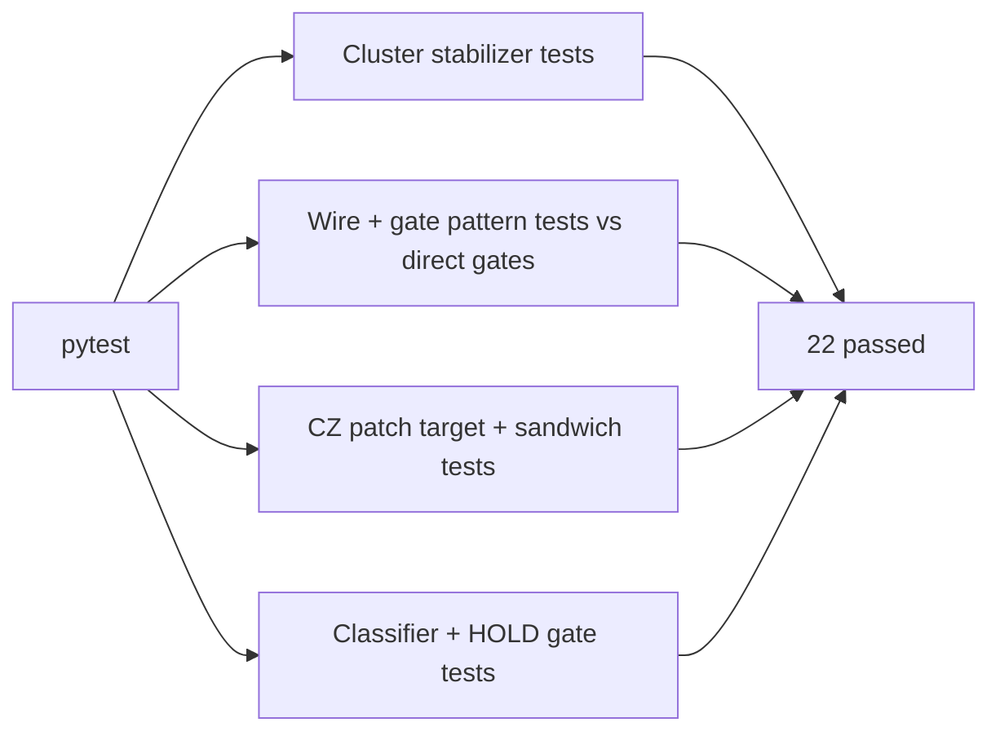
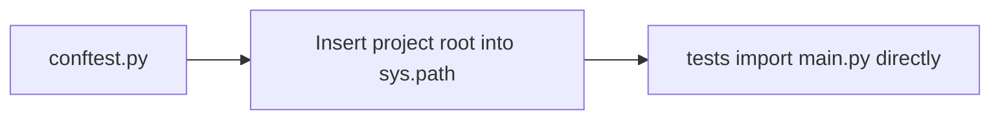
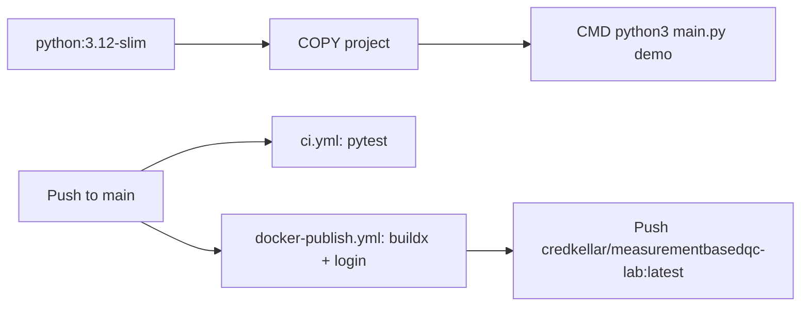

# MeasurementBasedQC-Lab 🧮⚛️

**Measurement-Based Quantum Computing Lab — Cluster States, One-Way Wires, J-Gate Patterns & Pauli-Frame Feed-Forward** — by Darion Kellar

MeasurementBasedQC-Lab is an **educational measurement-based quantum computing (MBQC) lab** in ONE pure-Python file. It turns the usual circuit picture upside down:

- **Circuit model** = prepare |0>, then apply a sequence of unitary gates, then measure at the end. 🔧
- **Measurement-based model** = prepare |+> everywhere, entangle **once** with controlled-Z gates into a **cluster state**, and from then on the *only* operations are single-qubit measurements. Choosing the measurement angles *is* the program; the randomness of the outcomes is absorbed by classical **feed-forward** and an exactly tracked **Pauli frame**. 📐

The lab proves the model honestly, by **enumeration, not sampling**: every measurement branch of every pattern is executed, each branch's probability is asserted to be exactly 1/2 per measurement, the corrected output is compared against direct gate application on a grid of input states, and every branch's Pauli frame is fitted to an affine function of the outcome bits over GF(2). The two-qubit result is stated exactly as it computes: the 2×3 patch with all-X measurements implements **(H ⊗ H) CZ (H ⊗ H)** — a CZ in the Hadamard frame, locally equivalent to CZ and maximally entangling — **not** a bare CZ, and sandwiching it between Hadamard patterns recovers CZ exactly (asserted to 8.88e-16).

Honest scope, stated up front: this is an exact statevector simulation of small patterns (at most 9 qubits). No real quantum hardware exists here, no quantum advantage is claimed, and every hardware / service / cryptographic use sits behind a permanent HOLD gate (14 total). 🔒

[](https://github.com/kimanicollier44-cmyk/MeasurementBasedQC-Lab/actions/workflows/ci.yml)
[](https://github.com/kimanicollier44-cmyk/MeasurementBasedQC-Lab/actions/workflows/docker-publish.yml)

> ℹ️ These are the **live** workflow badges for this repo. They activate as soon as the `ci.yml` and `docker-publish.yml` files from the paste pack are pasted into `.github/workflows/` — until then they have nothing to report yet.

## 🧰 Tech Stack Badges & Full Architecture Tech Stack

### 💻 Core Programming Languages & Core Systems


-2ea44f)

- 🐍 Python 3.12, pure standard library (`cmath`, `math`, `hashlib`, `json`, `sys`) — zero dependencies, zero network, deterministic (double-run byte-identical)
- ⚛️ Statevector core from scratch: flat complex amplitude lists (qubit q = bit q), single-qubit gates, CZ, XY-plane measurement with basis rotation back to computational form — no library quantum code anywhere
- 🧩 Cluster builder: |+>^n plus one CZ per graph edge (chains to 6 qubits, 2×3 and 3×3 patches), with the stabilizer receipt K_a = X_a ∏ Z_neighbours applied to the built state operator-by-operator
- 📐 Pattern engine: J-gate steps J(α) = H·Rz(α), feed-forward angle rule φ = −(−1)^x·α + π·z, and a Pauli frame tracked as a matrix (P′ = X^s·J(−φ)·P·J(α)⁻¹) and asserted to stay inside the Pauli group at every step
- 🔀 Branch enumeration: all 2^m outcome branches run deterministically — the seeded splitmix64 PRNG (seed 20261119) only picks probe input states, it never samples a branch
- 🧠 TinyML kNN pattern classifier (from scratch, stdlib, distance-weighted): resource-state / wire / single-step-gate / rotation-gate / entangling-gate from (measurements, outputs, cross edges, nonzero angles), labels from the lab's own policy
- 🪑 Council seats: Gemini Argon 4 DECIDER (names-only, tighten-only) + Muse advisor (never overrides HOLD) + Google Flow plan-only (rendered = False, live = 0)

### ⛓️ Web3 & Infrastructure

- 🚫 **Not applicable — honestly.** No blockchain, no Web3, no tokens: the "infrastructure" in this lab is one offline file holding a cluster state and a measurement-pattern engine. Quantum-hardware control, cloud quantum services, and blind-computing services are permanent HOLD gates, not features. No fake badges here.

### ⚙️ Platform Support & Hardware Architecture


- 🖥️ Pure Python — runs anywhere Python 3.12+ runs (Linux, macOS, Windows), plus the `python:3.12-slim` Docker image
- 🔒 No hardware is controlled, ever: real photonic processors, cluster-state sources, and detectors are permanent HOLD gates (see the gate table below)

### ⚡ Low-Level Infrastructure & Performance

- 🚫 **No low-level code — honestly.** No C, no C++, no GPU, no compiled extensions: this is one interpreted Python file on purpose, so every amplitude can be read, checked, and diffed. Performance here means honest algorithms — exhaustive branch enumeration instead of Monte Carlo, exact Pauli-frame matrix tracking instead of post-hoc fitting, and an affine GF(2) fit that either holds on all 16 patch branches or fails the build.

### 🛠️ DevOps & Build Tools


- 🐳 Docker (`python:3.12-slim`), GitHub Actions CI + Docker Publish (delivered in the paste pack)
- 🎯 Target image: `credkellar/measurementbasedqc-lab:latest`
- 🧪 Tests: `pytest` (22 tests) + the built-in CHECKS suite (48 checks) in `main.py`

### ☁️ Cloud Providers

- 🚫 **None — honestly.** No cloud provider is used or needed: the lab runs fully offline on your own machine or in a local Docker container. Docker Hub appears only as the registry the publish workflow pushes the image to.

## What this does?

1. 🧩 **Cluster states with a receipt** — chains (2–6 qubits) and 2×3 / 3×3 patches are built from |+>^n + CZ edges, and every stabilizer K_a = X_a ∏ Z_neighbours is applied to the built state: ‖K_a|ψ⟩ − |ψ⟩‖ = **0.00e+00** at every site, while a product state fails the same test loudly. Single-qubit marginals come out maximally mixed (purity exactly 0.5) — the entanglement is really there.
2. 🎲 **Randomness, priced exactly** — every XY-plane measurement in every pattern is asserted to land 50/50 (worst deviation from 1/2: **6.11e-16**). The outcomes are random; the computation is not, because the randomness only ever multiplies the logical state by a known Pauli.
3. 🚇 **The one-way wire** — teleportation along a linear cluster: 1 step implements H, 2 steps implement the identity, 4 steps implement the identity — on **every** branch (2, 4, and 16 branches × 14 input states), after the tracked Pauli correction, to ≤ **5.55e-16**.
4. 🎛️ **J-gate patterns** — measuring at angle φ implements J(−φ) = H·Rz(−φ) up to X^s. Two steps compose into exact rotations: Rz(θ) for θ ∈ {0.7, −1.3, π/3} and Rx(θ) for θ ∈ {0.7, −2.0}, each asserted against direct matrix application on the whole input grid, all branches.
5. 🌀 **General rotations (Euler)** — three J-steps implement H·Rz·Rx·Rz; four steps (the last at angle 0) implement the exact Euler form Rz(α)·Rx(β)·Rz(γ). Both are asserted against independently built matrix products — the pattern's unitary is never taken on faith.
6. 🔀 **Feed-forward, not hope** — later measurement angles are bent by earlier outcomes via φ = −(−1)^x·α + π·z, where (x, z) is the current Pauli frame. The frame is tracked as a matrix through the pattern and asserted to remain a Pauli at every single step — if the angle rule were wrong, the frame would leave the Pauli group and the build would fail.
7. 🧮 **The two-qubit patch, honestly named** — the 2×3 patch (one vertical CZ edge) with all-X measurements implements **(H ⊗ H) CZ (H ⊗ H)**: a −1 phase on |−−⟩ instead of |11⟩. All 16 branches × 10 input pairs correct to ≤ **6.66e-16**; the gate is maximally entangling (concurrence of U|00⟩ = 1.0); and (H ⊗ H)·U·(H ⊗ H) = CZ to 8.88e-16, so the patch plus Hadamard patterns *is* CZ — the bare patch alone is not, and the lab says so.
8. 🏷️ **Pauli-frame bookkeeping as data** — for the wire, the Euler pattern, and the patch, the lab prints the frame of every branch and fits it to an affine function of the outcome bits over GF(2). The fit holds on all branches of all three. Worked example (Euler pattern, branch 1010, input |+i⟩): uncorrected output is off by **0.1486**, the predicted frame is Z, and the corrected output matches to **3.33e-16**.
9. 🔍 **Probe states with a named seed** — the input grid is 6 axis states plus 8 states drawn from an in-file splitmix64 PRNG, **seed 20261119**, stated here and in the demo — so the "grid of inputs" is itself reproducible, and special (Pauli-eigenstate) inputs can't smuggle in a spurious frame: patch frames are extracted by intersecting candidate sets over generic probes until exactly one Pauli survives.
10. 🏛️ **Classifier + seats + checks** — a from-scratch distance-weighted kNN labels pattern shapes (resource-state / wire / single-step-gate / rotation-gate / entangling-gate) from the lab's own policy, with Argon 4 DECIDER (sha256 trace), Muse advisor, Google Flow plan-only, and a built-in CHECKS suite (48 checks).

## 🗺️ How it works — diagram per script

### `main.py` — the whole lab

```mermaid
flowchart TD
    A[CLI: demo / checks / cluster / wire] --> B[Statevector Kit: gates + CZ + measurement]
    B --> C[Cluster Builder: |+>^n + CZ edges]
    C --> D[Stabilizer Receipts: K_a |psi> = |psi>]
    C --> E[Pattern Engine: J-steps + feed-forward angles]
    E --> F[Pauli Frame Tracker: matrix, asserted Pauli]
    F --> G[Branch Enumeration: all 2^m branches]
    G --> H[Wire / Rz / Rx / Euler Patterns]
    C --> I[2x3 Patch: all-X measurements]
    I --> J[Target: HxH . CZ . HxH + frame intersection]
    H --> K[Affine GF(2) Frame Fit]
    J --> K
    K --> L[kNN Pattern Classifier]
    L --> M[Argon 4 DECIDER + Claude Advisor]
    M --> N{HOLD Gates x14}
    N -->|hardware / services / crypto| O[HOLD - exit 2]
    N -->|sandbox sim| P[CHECKS + VERDICT PROCEED]
```

### `tests/test_main.py` — verification



### `conftest.py` — test path setup



### `Dockerfile` + CI flow — container & publish



## Why is this cool?

1. 🔀 Computing by *measuring* actually works, and here it's proven branch by branch: 16/16 Euler branches and 16/16 patch branches land exactly on the target gate.
2. 🎲 The outcomes are genuinely 50/50 random — and the computation is deterministic anyway. The lab shows both facts with numbers (prob deviation ≤ 6.11e-16, corrected deviation ≤ 6.66e-16) instead of asserting either.
3. 🧩 The cluster state's stabilizers don't just "hold" — they're applied to the built statevector and come back with deviation **exactly 0.00e+00**, while a product state fails the same test.
4. 🏷️ The Pauli frame isn't fitted after the fact: it's tracked as a matrix *during* the pattern and asserted to stay a Pauli at every step, so the bookkeeping is part of the computation, not a story about it.
5. 🧮 The frame tables collapse into affine GF(2) formulas in the outcome bits — the classical side of MBQC reduced to linear algebra you can verify by hand.
6. 🎛️ J-gate patterns make *any* single-qubit rotation out of measurements alone: Rz, Rx, and a full Euler decomposition, each graded against the direct matrix.
7. ⚖️ The two-qubit gate is named with total honesty: (H ⊗ H) CZ (H ⊗ H), maximally entangling, locally equivalent to CZ — and the sandwich identity that turns it into CZ is itself a checked line.
8. 🔍 Frame extraction is adversarial about its own inputs: Pauli-eigenstate probes admit spurious frames, so the lab intersects candidate sets over generic seeded probes until exactly one Pauli survives per branch.
9. 🎯 Deterministic end to end: run it twice, get byte-identical output — a quantum computer you can diff.
10. 🪑 The council seats are part of the pattern: Argon 4 can only tighten HOLDs, Muse advises, Flow plans — none of them can turn a simulation into a service claim.

## What problems this solves?

1. ❌ **Problem:** MBQC is usually explained with hand-waving about "measurements doing gates". ✅ **Solution:** Every gate here is a pattern whose output is compared, branch by branch, against direct gate application on 14 input states.
2. ❌ **Problem:** "Random outcomes but deterministic computation" sounds like a contradiction. ✅ **Solution:** The lab prices both halves: outcome probabilities are 1/2 to within 6.11e-16, and the corrected outputs are exact to within 6.66e-16 — the Pauli frame is the bridge, shown as data.
3. ❌ **Problem:** Textbook diagrams quietly use the all-zeros measurement branch. ✅ **Solution:** All 2^m branches are enumerated for every pattern — the convenient branch is 1 of 16, and the other 15 are checked too.
4. ❌ **Problem:** Feed-forward is often described but never verified. ✅ **Solution:** The angle rule φ = −(−1)^x·α + π·z drives the simulation, and the matrix-tracked frame staying Pauli at every step is the verification.
5. ❌ **Problem:** The 2×3 patch is frequently mislabelled as "a CZ gate". ✅ **Solution:** The implemented unitary is computed from the statevector and matched to (H ⊗ H) CZ (H ⊗ H); its distance from bare CZ is itself a check (> 0.5), and the H-sandwich that recovers CZ is asserted separately.
6. ❌ **Problem:** Cluster-state claims are easy to fake with a pretty picture. ✅ **Solution:** Stabilizers are applied to the built state (deviation 0.00e+00), marginals are maximally mixed (purity 0.5), and a product state is shown failing the same stabilizer test.
7. ❌ **Problem:** Simulation grids often cherry-pick easy input states. ✅ **Solution:** The grid mixes the 6 axis states with 8 seeded-PRNG states (seed 20261119, named in the open), and frame extraction intersects over generic probes precisely so eigenstate inputs can't cheat.
8. ❌ **Problem:** "Up to a Pauli correction" hides a multitude of sign errors. ✅ **Solution:** The uncorrected output is asserted to equal frame × target (not just "close after correction"), and the worked example prints both deviations: 0.1486 before, 3.33e-16 after.
9. ❌ **Problem:** Pattern catalogues don't say what kind of thing a pattern is. ✅ **Solution:** A policy-labelled kNN classifier (resource-state / wire / single-step / rotation / entangling) whose agreement with the policy is asserted on every grid row.
10. ❌ **Problem:** Simulation tools quietly imply a quantum service is next. ✅ **Solution:** 14 named HOLD gates return exit code 2 for every hardware, cloud-service, blind-computing, cryptographic, or advantage claim, forever.

## How to install this?

1. 📋 Clone or download this project folder.
2. 🐍 Make sure Python 3.12+ is installed: `python3 --version`
3. ▶️ Run the full demo + checks (no arguments needed):

```bash
python3 main.py
```

4. 🧪 Run the test suite:

```bash
pip install pytest
python3 -m pytest -q
```

5. 🎛️ Try the other commands:

```bash
python3 main.py checks    # 48 built-in checks
python3 main.py cluster   # cluster states + stabilizer receipts (JSON)
python3 main.py wire      # one-way wire reports, 1/2/4 steps (JSON)
python3 main.py gates     # H / Rz / Rx / Euler pattern reports (JSON)
python3 main.py cz        # 2x3 patch report: target, frames, concurrence (JSON)
python3 main.py frame     # Pauli-frame tables + affine fits (JSON)
python3 main.py classify  # kNN pattern classifier report
python3 main.py brains    # Argon 4 + Muse + Flow seats
python3 main.py holds     # list all 14 HOLD gates
python3 main.py hold-demo # exits 2 - gated actions stay HOLD
```

6. 🐳 Or run it in Docker:

```bash
docker build -t credkellar/measurementbasedqc-lab:latest .
docker run --rm credkellar/measurementbasedqc-lab:latest
```

## Requirements

- 🐍 Python 3.12 or newer
- 📦 Dependencies: **none** (standard library only)
- 🌐 Network: **none** — fully offline
- 🧪 For tests only: `pytest`
- 🐳 Optional: Docker

## FULL project structure tree

```text
measurementbasedqc-lab/
├── main.py                  # the whole lab: statevector kit, cluster builder, stabilizers, pattern engine, Pauli-frame tracker, CZ patch, classifier, seats, HOLD gates
├── conftest.py              # puts the project root on sys.path for tests
├── tests/
│   └── test_main.py         # 22 pytest tests: stabilizers, wire, gates, patch, frames, classifier, gates, determinism
├── assets/
│   └── cover.png            # README cover image (2736 x 912)
├── Dockerfile               # python:3.12-slim, runs the demo
├── .gitignore               # __pycache__/, .pytest_cache/, *.pyc
└── README.md                # this file
```

> 📦 Delivered separately as paste packs (not in this tree): `.github/workflows/ci.yml` + `docker-publish.yml`, and the Docker Hub pack (100-char description, 350-char About, overview, categories).

## 🔒 HOLD gates — all 14, permanent

| # | Gate | What stays held |
|---|------|-----------------|
| 1 | `real_hardware_control` | No control of real quantum hardware, photonic processors, or cluster-state sources |
| 2 | `quantum_advantage_claim` | No claim of quantum advantage or speedup from a teaching simulation |
| 3 | `cryptographic_use_claim` | No cryptographic product; no QKD, encryption, or security claim |
| 4 | `blind_computing_service_claim` | No blind or verified quantum-computing service (MBQC is the basis of BQC — gated for exactly that reason) |
| 5 | `production_compiler_claim` | Not a production MBQC compiler or pattern optimiser for real devices |
| 6 | `fault_tolerance_product_claim` | Bare patterns are not fault tolerance; no error-corrected product claim |
| 7 | `cloud_quantum_service_claim` | No cloud quantum-computing service is offered or implied |
| 8 | `hardware_fabrication_claim` | No fabrication guidance for photonic chips, sources, or detectors |
| 9 | `medical_claim` | No medical, diagnostic, or life-support computation claim |
| 10 | `financial_claim` | No trading, pricing, risk, or financial-computation claim |
| 11 | `investment_claim` | No investment claims; a lab model is not a prospectus |
| 12 | `military_surveillance_claim` | No military, intelligence, or surveillance use |
| 13 | `claim_certified_system` | No claim this simulation is a certified quantum computer |
| 14 | `remove_human_override` | The human override is never removed |

🧑‍⚖️ **Council seats:** Gemini Argon 4 Extended Thinking — DECIDER (names-only, tighten-only, MAP → MODEL → STRESS → DECIDE, sha256 trace, `can_override_hold = False`) · Muse — advisor (`can_override_hold = False`) · Google Flow — plan-only (`rendered = False`, `live = 0`).

✅ **Verification:** pytest **22 passed** (project + clean copy) · built-in CHECKS **48/48** · double-run output **byte-identical** · `hold-demo` exits **2** · `main.py` **999 lines**, pure stdlib, zero network.

## 🧒 5th-grade English section

Imagine you build a huge **domino maze** out of tiny quantum balls, all holding hands in a grid. 🤝

- First you set up the whole maze — every ball holding hands with its neighbours. That hand-holding web is called a **cluster state**, and this lab checks the hand-holds with a special rule at every ball. The rule passes *perfectly*, every time. 🧩
- Then you never push the balls again. You just **look** at them, one by one, in a careful order — and somehow, looking *is* the computing! Each look gives a random answer, like a coin flip. 🎲
- Random answers sound useless, but every coin flip only ever twists the final answer in one of four simple ways. So you keep a **score card** of the twists — scientists call it the **Pauli frame** — and at the end you untwist, and the answer is *exactly* right. This lab checks every possible run of coin flips, not just a few. 🏷️
- By choosing the *angle* you look from, you can make the maze do real tricks: copy a ball's secret along a line, flip it, spin it by any angle you like. 📐
- Two lines of the maze holding hands can even do a trick that tangles two answers together — the lab is careful to give that trick its exact true name, not a close-enough name. ⚖️
- This project is a **pretend lab on a computer**. It does not run a real quantum computer. It helps you learn how looking at things, in the right order, with a good score card, can be a computer all by itself. 💻

---

MIT © 2026 Darion Kellar · MeasurementBasedQC-Lab — educational simulation only 🧮
